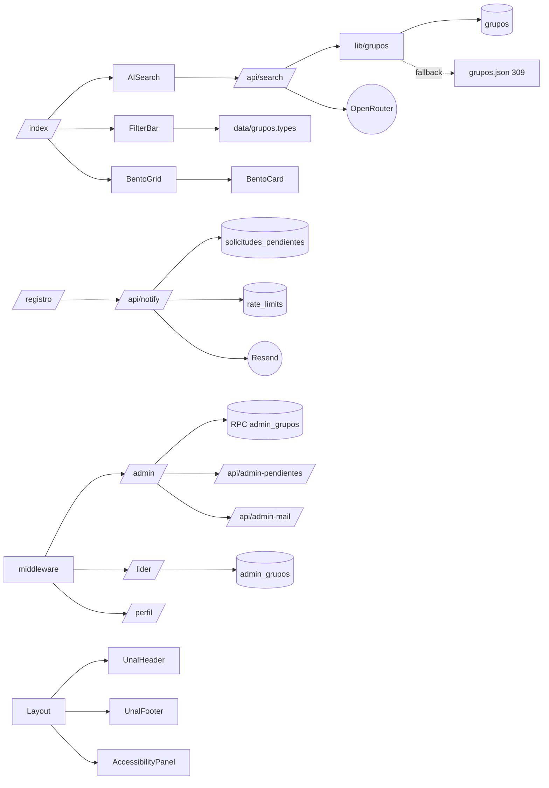

# Grafo de conocimiento: Semilleros UNAL

Resumen para un modelo que vaya a rediseñar el proyecto. El grafo completo, con nodos, aristas e issues, está en [`knowledge-graph.json`](./knowledge-graph.json). Este archivo es la versión legible.

## 1. Qué es

Catálogo público de 309 grupos (281 de investigación, 15 semilleros, 13 estudiantiles) de la Facultad de Ingeniería y Afines de la UNAL Bogotá. Incluye búsqueda con IA, filtros, postulación de grupos y paneles por rol.

- **Stack:** Astro 4 (páginas dinámicas con `prerender = false`), Tailwind 3, Supabase (Postgres, Auth, Storage), Vercel, Resend, OpenRouter.
- **Tamaño:** unas 14.500 líneas en `src/`.

## 2. Mapa del sistema

## 3. Rutas y roles

| Ruta | Acceso | Función |
|------|--------|---------|
| `/` | público | Hero, stats, búsqueda IA, filtros, catálogo |
| `/grupo/[id]` | público | Detalle de grupo aprobado |
| `/registro` | público | Postulación en 3 pasos, sube imagen |
| `/login` | público | Auth Supabase, redirige según rol |
| `/perfil` | sesión | Datos del usuario |
| `/lider` | ADMIN_GRUPO | Edita sus grupos asignados |
| `/admin` | SUPER_ADMIN | Grupos, pendientes, usuarios, correo |
| `/privacidad` | público | Política de privacidad |
| `/sitemap.xml` | público | Generado desde Supabase |

## 4. Base de datos

- **Tablas:** `perfiles`, `grupos`, `solicitudes_pendientes`, `admin_grupos`, `audit_log`, `rate_limits`.
- **RPC:** `get_my_role`, `is_admin_of_group`, `is_super_admin`, `get_manageable_groups`, `assign_admin_to_group`, `remove_admin_from_group`.
- **Triggers:** `protect_grupos_moderation` (solo SUPER_ADMIN cambia moderación), `update_fecha_actualizacion`.
- **Storage:** bucket `imagenes-grupos`.
- **Edge function:** `supabase/functions/notify-admins`.

## 5. Modelo de datos del grupo

Tipo `Grupo` en `src/data/grupos.types.ts`. Campos principales: `id`, `tipo`, `nombre`, `carreras`, `docente_a_cargo`, `lider_o_representante`, `email_contacto`, `vinculacion`, `enfoque`, `descripcion`, `actividades`, `modalidad`, `horarios_habituales`, `requisitos_ingreso`, `nivel_academico_recomendado`, `redes_sociales`, `comentarios_adicionales`, `imagen_url`, y fechas. Las carreras se normalizan con `canonicalizeCarrera` y `norm`.

## 6. Problemas detectados

Ordenados por severidad. Detalle y archivos en el JSON (`issues`).

1. **Alta: `<main>` anidado.** `Layout.astro` envuelve el slot en `<main>` y `index.astro` abre otro `<main>`.
2. **Alta: tres sistemas de color.** La paleta UNAL oficial (lima `#94B43B`), la FIBOG (navy `#192950`, teal `#088577`) y los tokens de `global.css` no son el mismo conjunto. La captura `screenshots/our-fullpage-final.png` muestra verde oliva que ya no corresponde al código actual, así que probablemente es una versión anterior.
3. **Media: tema por defecto.** `CLAUDE.md` dice dark por defecto. `Layout.astro` sigue la preferencia del sistema.
4. **Media: tipografía.** La documentación dice Ancizar Sans. El código carga Inter y JetBrains Mono, y Google Fonts se importa dos veces.
5. **Media: documentación desactualizada.** `ServicesTab`, `Breadcrumb` y `GrupoModal` aparecen en la documentación, pero no existen o no se usan. No se encontró breadcrumb en las páginas, aunque el checklist de cumplimiento lo marca como hecho.
6. **Media: contenido fijo.** `totalAreas = '12+'`, fallbacks 309 y 15, y textos del hero sin fuente de datos.
7. **Media: fallback silencioso a `grupos.json`.** La captura muestra "13 grupos" mientras el JSON tiene 309.
8. **Media: archivos grandes.** `admin.astro` (1265 líneas), `lider.astro` (941) y `FilterBar.astro` (888) mezclan markup y lógica en `<script>` inline. `admin` usa `@ts-nocheck`.
9. **Baja:** `theme-color` distinto al documentado, scripts de seed con solapamiento, GSAP sin fallback si falla el CDN, una migración sin prefijo de fecha.

## 7. Restricciones para el rediseño

- Mantener header, footer y panel de accesibilidad según la plantilla web UNAL. El breadcrumb también es obligatorio en páginas internas.
- Mantener las rutas, los roles y los contratos de API listados arriba.
- Mantener el tipo `Grupo` y los filtros tipo, carrera y búsqueda.
- Tokens CSS con modo claro y oscuro. Contraste WCAG AA mínimo (4,5:1), navegación por teclado y `prefers-reduced-motion`.

## 8. Referencias de inspiración (Awwwards y similares)

Estas referencias son páginas de categoría de Awwwards y un artículo de 2026. Revisé sus descripciones, no los sitios individuales premiados. Conviene abrir cada enlace para elegir ejemplos concretos.

- [Institutions: sitios institucionales premiados](https://www.awwwards.com/websites/institutions/). Es la referencia más cercana a una universidad.
- [Culture & Education](https://www.awwwards.com/websites/culture-education/). Catálogos y sitios académicos.
- [Gallery](https://www.awwwards.com/websites/gallery/). Grids de tarjetas para el catálogo de grupos.
- [Clean](https://www.awwwards.com/websites/clean/). Jerarquía tipográfica y espacio en blanco.
- [UI Design](https://www.awwwards.com/websites/ui-design/). Filtros, búsqueda y estados de interfaz.
- [Sites of the Year](https://www.awwwards.com/websites/sites_of_the_year/). Referencias de alta calidad.
- [15 Best Website Design Examples 2026, Wavespace](https://www.wavespace.agency/blog/best-website-design-examples). Selección con análisis de por qué funcionan.

Contenido reformulado para cumplir con las restricciones de licencia.

## 9. Cómo usar este grafo

Pásale a otro modelo `docs/knowledge-graph.json` junto con este archivo. El JSON contiene la estructura y los problemas. Este Markdown contiene el contexto y las restricciones. Con eso el modelo puede rediseñar sin volver a leer las 14.500 líneas del código.
